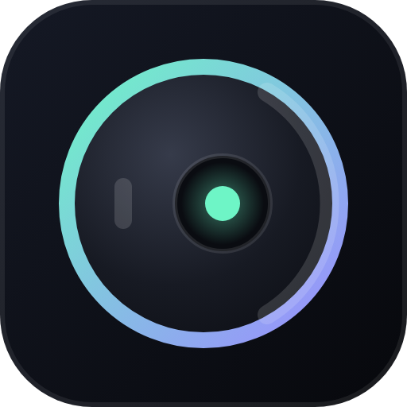
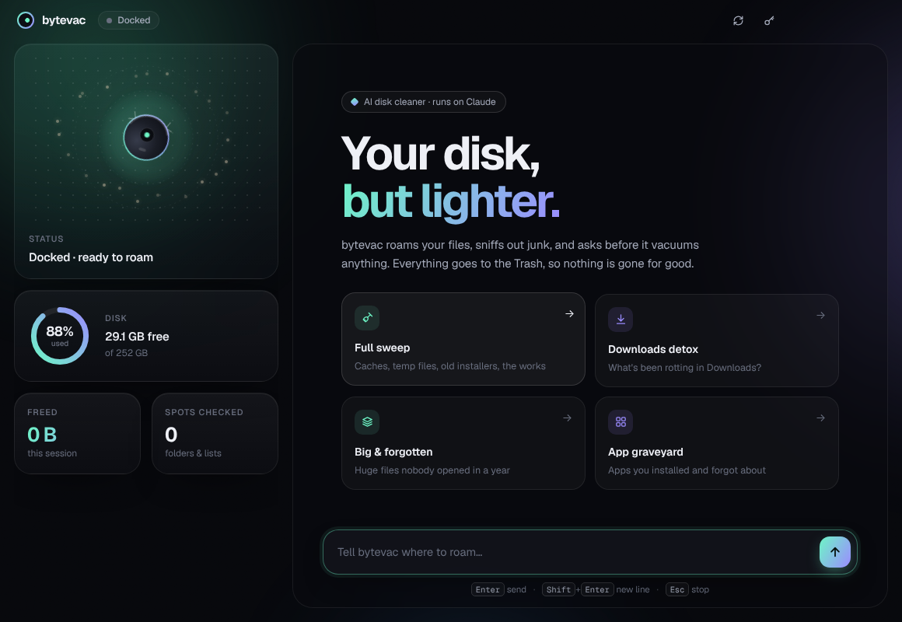
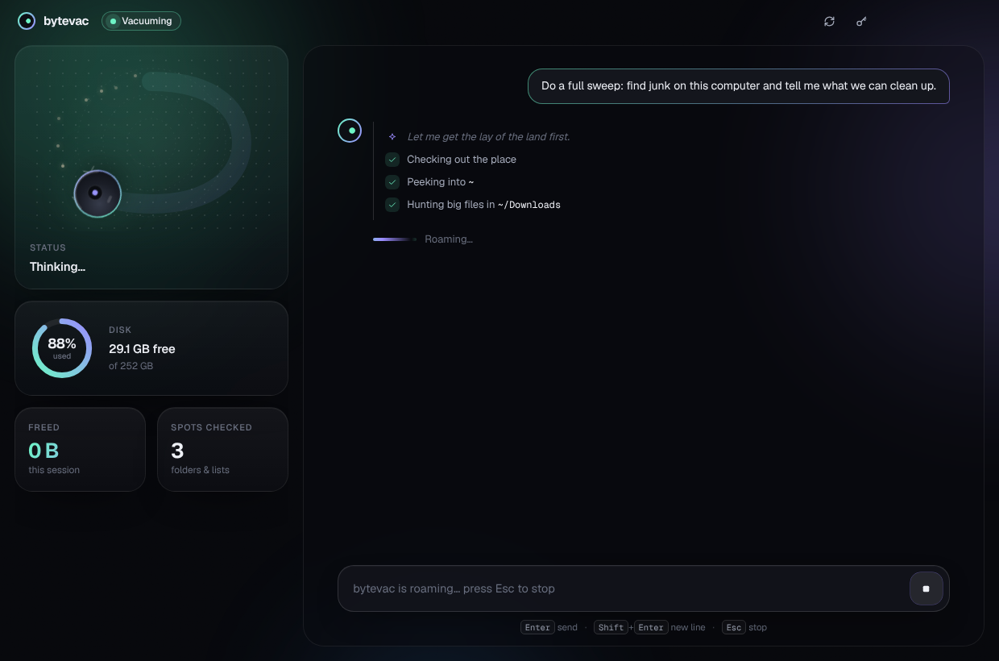
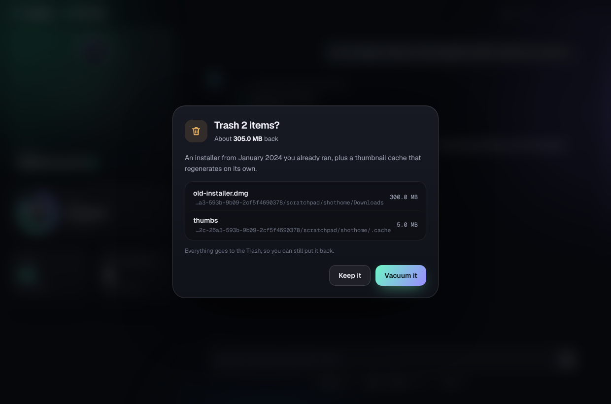
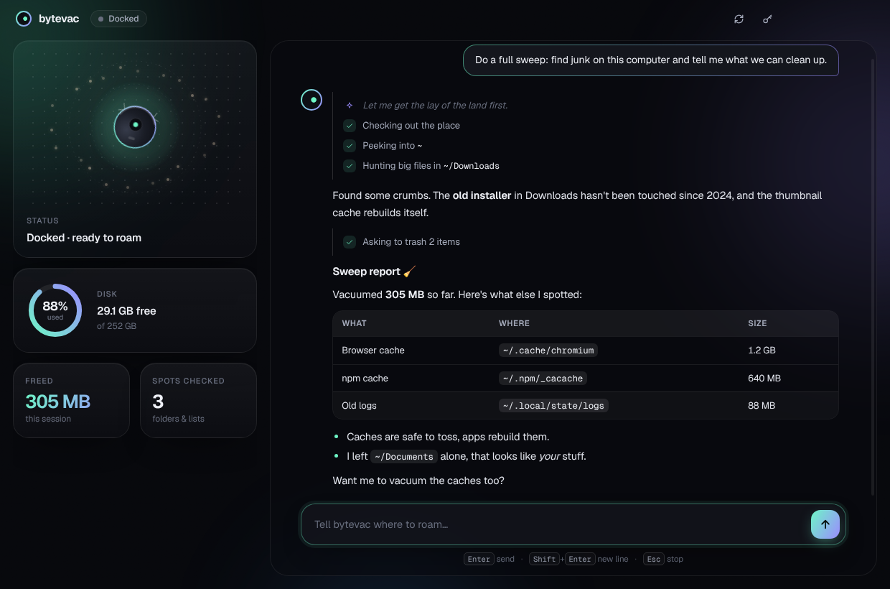

<div align="center">



# bytevac

**A robot vacuum for your computer.**
It roams your disk, sniffs out junk, and asks before it sucks anything up.

</div>



bytevac is a desktop app with an AI inside. Hit **Full sweep** and a little robot starts rolling
around your home folder, hunting for the stuff that quietly eats your disk: caches, temp files,
ancient installers, 4 GB videos you downloaded in 2021, and apps you forgot you had. Then it
tells you what it found, biggest wins first, and offers to clean it up.

It's an uninstaller and a disk cleaner that can actually *think* about what it's looking at.

| Roaming | Asking first | The report |
|---|---|---|
|  |  |  |

## 🛡️ It won't eat your homework

- **Nothing happens without you.** Every trash or uninstall opens a sheet listing exactly what goes, how big it is, and why. **Keep it** has focus, and Esc means no.
- **Trash, not delete.** Files go to the Trash / Recycle Bin, so you can always fish them back out.
- **Fenced in.** It can only look inside your home folder, the temp folder, and (on macOS) `/Applications`. Symlinks that point outside are blocked.
- **Your stuff stays yours.** It won't trash your home, Desktop, Documents, Downloads, Pictures and friends as a whole, and it's told never to call personal files junk on its own.

## 🚀 Run it

You need an [Anthropic API key](https://console.anthropic.com/settings/keys). On first launch bytevac asks for it
and stores it encrypted with your OS keychain. (`ANTHROPIC_API_KEY` in the environment works too.)

**Portable build** (no Node.js needed): run `npm run pack -- win32 x64` (or `darwin arm64`, `linux x64`)
on any machine, unzip `dist/bytevac-<platform>-<arch>` wherever you like and open `bytevac.exe` / `bytevac.app` / `bytevac`.

**From source:**

```bash
git clone https://github.com/MarkArtemyev/bytevac.git
cd bytevac
npm install
npm start
```

Then hit a card, or just type: *"only look at my Downloads"*, *"what apps haven't I used in a year?"*.
It answers in whatever language you write in.

## 🧠 How it works

A thin [Electron](https://www.electronjs.org/) shell around Claude, using the
[Anthropic SDK](https://github.com/anthropics/anthropic-sdk-typescript) tool runner with streaming.
The model gets six tools and drives the loop itself:

| Tool | What it does |
|---|---|
| `system_info` | OS, free space, the usual junk hideouts for this platform |
| `list_directory` | What's in a folder, biggest first |
| `find_large_files` | Big (and optionally old) files under a folder |
| `list_installed_apps` | `/Applications` on macOS, the registry on Windows, flatpak/snap on Linux |
| `move_to_trash` | Moves files to the Trash, after you say yes |
| `uninstall_app` | Trashes the `.app` (macOS), opens the app's own uninstaller (Windows), or removes the flatpak/snap (Linux), after you say yes |

```
src/
  main.js        window, API key storage, the "are you sure?" round trip
  agent.js       the brain: Claude + streaming tool loop + conversation memory
  tools.js       everything the robot is allowed to do
  preload.js     the bridge between the window and the main process
  ui/
    index.html   layout: the dock, the stage, the sheets
    styles.css   the look (Geist, glass, aurora, the roaming robot)
    app.js       chat feed, live tool trace, stats, confirm sheet, onboarding
    markdown.js  tiny escape-first Markdown renderer for reports
scripts/pack.js  portable builds for Windows, macOS and Linux
```

`npm run check` type-checks the whole thing.

## 🗺️ Ideas for later

- [ ] Leftover hunting after uninstall (`~/Library/Application Support`, `%APPDATA%`)
- [ ] Duplicate file finder
- [ ] "Dust report" history: how much bytevac has vacuumed over time
- [ ] Signed installers (`.dmg`, `.msi`)

## ⚠️ Disclaimer

bytevac asks before every cleanup, but you're the one clicking **Vacuum it**. Read the sheet.
No warranty, no refunds, no hard feelings.

## 📜 License

[MIT](LICENSE). Geist font by Vercel under the [SIL Open Font License](src/ui/fonts/OFL.txt).
